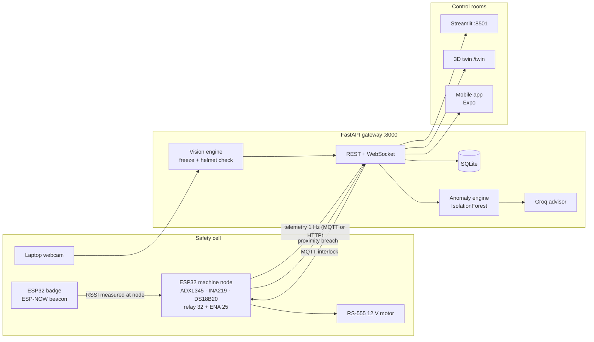

# A.R.M.O.R. — Active Real-Time Machine & Operator Response System

Internal codename for **MachinoCare 2.0**: a closed-loop cyber-physical worker-safety
cell. Machine telemetry, badge proximity, edge vision and a physical motor interlock
share one state machine, so a PPE violation actually cuts power instead of only
lighting up a dashboard.

Three surfaces read that state: the **Streamlit Operator Control Room**, the
**3D digital twin**, and the **ARMOR mobile app**.

---

## Repository layout

```
armor/                          # main branch — gateway, dashboard, twin, docs
├── README.md
├── docs/
│   ├── ARMOR Merged Build Spec.md                     # Scope + decision log (read first)
│   ├── ARMOR_System_Architecture_and_Implementation_Plan.md
│   ├── ARMOR_24Hour_Work_Division_and_Roadmap.md
│   ├── hardware-pinout.md                             # Authoritative ESP32 pinout
│   └── data-streaming.md                              # Topics, payloads, contracts
├── armor-backend/
│   ├── backend/
│   │   ├── main.py          # FastAPI gateway: ingest, safety, vision, ML, WS, /twin
│   │   ├── models.py        # Pydantic payload schemas
│   │   ├── storage.py       # SQLite (telemetry, machine_state, incidents, badges, …)
│   │   ├── vision.py        # Person-gated freeze + Roboflow helmet workflow
│   │   ├── ml_engine.py     # Multi-modal IsolationForest + decomposition
│   │   └── groq_advisor.py  # Groq LLM predictive-maintenance advisory
│   ├── dashboard/app.py     # Streamlit Operator Control Room
│   ├── static/twin.html     # Three.js digital twin (served at /twin)
│   ├── scripts/mqtt_debug.py
│   ├── test_backend.py      # End-to-end backend tests
│   ├── test_vision.py
│   ├── test_roboflow.py
│   ├── requirements.txt
│   └── .env.example
├── start.ps1 / start.bat / start.sh
└── stop.ps1  / stop.bat  / stop.sh
```

### Branches

| Branch | Contents |
|---|---|
| `main` | FastAPI gateway, Streamlit dashboard, 3D twin, docs (this branch) |
| `hardware` | ESP32 firmware — machine node, wearable badge, pinout + streaming docs |
| `armor-app` | **Orphan branch**: the ARMOR mobile app (React Native / Expo). No shared history with `main`; changes are ported by hand in both directions |

---

## Architecture



**Loop, in one line:** badge enters 1.5 m → node posts a proximity breach → vision
freezes the frame, checks PPE → violation (or an ML anomaly window) → `LOCKOUT`
published to the node → relay + ENA go LOW → incident, snapshot and Telegram alert
are logged → operator resets from the dashboard or the app.

---

## Quick start

### Prerequisites

- Python 3.11+
- Mosquitto (or any MQTT broker) on `localhost:1883` for hardware telemetry — the
  HTTP ingest path works without a broker
- Webcam for the vision panel (optional; the rest of the stack runs without it)
- Node 20+ only if you are running the mobile app

### One-click (backend + dashboard)

```powershell
.\start.ps1          # or double-click start.bat
.\stop.ps1           # stop both
```

```bash
./start.sh           # Linux / macOS
./stop.sh
```

### Manual

```powershell
cd armor-backend
python -m venv .venv
.\.venv\Scripts\Activate.ps1
pip install -r requirements.txt
copy .env.example .env      # then edit .env

# Terminal 1 — gateway
python -m uvicorn backend.main:app --host 0.0.0.0 --port 8000

# Terminal 2 — control room
streamlit run dashboard/app.py --server.port 8501

# Terminal 3 — inspect raw MQTT traffic (optional)
python scripts/mqtt_debug.py
```

### Where things live

| URL | What |
|---|---|
| `http://localhost:8000/docs` | Interactive OpenAPI docs (every endpoint below) |
| `http://localhost:8000/twin` | 3D digital twin (standalone, also embedded in the dashboard) |
| `http://localhost:8000/api/v1/vision/frame` | Latest camera frame as a single JPEG |
| `http://localhost:8501` | Streamlit Operator Control Room |

`--host 0.0.0.0` matters: phones and the ESP32 reach the gateway over the LAN, not
through `127.0.0.1`. See [Troubleshooting](#troubleshooting) for the LAN address
discovery and firewall notes.

---

## API surface

Full schemas: `/docs`. Grouped summary:

| Area | Endpoints |
|---|---|
| System | `GET /api/v1/health` · `GET /api/v1/debug/mqtt` |
| Telemetry | `POST /api/v1/telemetry` (202) · `GET /api/v1/telemetry/{device_id}?limit=` |
| Status | `GET /api/v1/status/{device_id}` · `GET /api/v1/devices` |
| Safety | `POST /api/v1/breach` (202) · `POST /api/v1/interlock` · `POST /api/v1/interlock/reset/{incident_id}` · `POST /api/v1/bench?enabled=` |
| Incidents | `GET /api/v1/incidents?device_id=&resolved=&limit=` · `GET /api/v1/incidents/{id}` |
| Workers | `POST /api/v1/workers` · `GET /api/v1/workers` · `DELETE /api/v1/workers/{badge_mac}` · `GET /api/v1/breaches` |
| Vision | `GET /api/v1/vision/frame` · `GET /video/stream` (MJPEG) · `GET /api/v1/vision/status` · `GET /api/v1/vision/state` · `POST /api/v1/vision/inspect` · `POST /api/v1/vision/inspect/start` · `GET /api/v1/vision/inspect/status` · `GET /api/v1/vision/snapshot/{filename}` · `POST /api/v1/vision/unfreeze` · `GET/POST /api/v1/vision/auto-freeze` · `GET/POST /api/v1/vision/dwell-seconds` |
| Calibration / ML | `POST /api/v1/calibrate` · `DELETE /api/v1/calibrate` · `GET /api/v1/model/{device_id}` · `GET /api/v1/anomalies` · `GET /api/v1/telemetry/anomaly/decomposition/{device_id}` · `GET /api/v1/telemetry/prediction/{device_id}` |
| Live stream | `WS /ws/live?device_id=machino_node_01` |
| Twin | `GET /twin?device_id=&host=&demo=1` |

### Interlock commands

`POST /api/v1/interlock?device_id=machino_node_01` — `command` is one of
`START`, `STOP`, `LOCKOUT`, `RESET`.

```json
{ "command": "START",
  "source": "MOBILE_APP",
  "reason": "Operator started motor from mobile app",
  "issued_by": "mobile_app" }
```

- `START` returns **409** while an interlock is active — the app surfaces that inline
  instead of pretending the motor started.
- `RESET` clears the lockout but does **not** spin the motor; a separate `START` is
  required. This mirrors the firmware rule `motor_requested && !interlock`.
- Every command is published on `machinocare/v1/devices/{device_id}/interlock` and
  written to `interlock_log`.

### Live snapshot (`WS /ws/live`)

```json
{
  "type": "snapshot",
  "device_id": "machino_node_01",
  "motor_state": "RUNNING",
  "interlock_active": false,
  "vicinity_presence_active": true,
  "vicinity_status": "AUTHORIZED_OPERATOR_PPE_VERIFIED",
  "proximity_breach_active": false,
  "active_worker_id": "BADGE-EMP-402",
  "is_anomaly": false,
  "anomaly_percentage": 12.4,
  "anomaly_window_count": 0,
  "top_contributor": "Motor Current (INA219)",
  "predictive_advisory": "…",
  "current_rms": 0.041,
  "current_temp_c": 31.2,
  "current_ma": 238.0,
  "latest_telemetry": { "...": "one row from the telemetry table" },
  "open_incidents": [],
  "timestamp": "2026-10-29T…"
}
```

Pushed every 0.75 s. Clients only need this one socket — the dashboard, twin and app
all read the same payload.

---

## Anomaly detection and advisory

1. **Features** — rolling windows over the telemetry stream produce 12 numbers:
   vibration (mean/std/max magnitude, crest factor), current (mean/std/max),
   voltage (mean/std), power (mean) and temperature (mean/max).
2. **Model** — per-device `IsolationForest` trained during calibration
   (`POST /api/v1/calibrate`, needs ≥ 8 windows), with a Ridge-distilled variant for
   faster scoring. Models persist under the backend data directory.
3. **Decomposition** — every scored window is broken back down per modality so the UI
   can name the dominant contributor instead of showing a bare percentage.
4. **Lockdown gate** — `ANOMALY_WINDOW_SECONDS` (default 5 s) with
   `ANOMALY_LOCKDOWN_THRESHOLD` (default 3) anomalous windows inside that window
   triggers an automatic `LOCKOUT`. Single spikes are ignored; a sustained trend is
   not. Tune both in `.env`.
5. **Advisory** — when a Groq key is configured, the multi-modal decomposition is sent
   to `GROQ_MODEL` (default `qwen/qwen3.8-27b`) for a short root-cause note. Results
   are cached (TTL) so sub-second telemetry does not spam the API. Without a key, or if
   the API call fails, a deterministic expert-rules fallback returns the note instead
   (`model_used: "expert-rules-fallback"`; nominal windows use
   `"rules-engine-nominal"`), so `predictive_advisory` is always populated.

---

## 3D digital twin

`static/twin.html` is a single self-contained page (three.js 0.162 via CDN importmap)
served at `/twin` and embedded in the dashboard's Vision panel.

- Machine body is the readout: spindle speed follows motor state and current draw,
  the motor assembly carries the vibration, paint glows with temperature, the brake
  caliper clamps on lockout, and the beacon is cyan idle / green running / amber
  degraded / strobing red on alarm.
- Safety ring, floor fill and worker marker (suit, hi-vis vest, helmet, footprint)
  follow proximity, PPE verdict and breach state.
- HUD: link badge with staleness, per-signal values, anomaly bar with contributor,
  vibration and temperature sparklines.
- Camera presets `ISO` / `FRONT` / `TOP`, orbit and zoom with the mouse.
- Query params: `device_id`, `host=ip:port` (gateway override), `demo=1`
  (scripted telemetry, no WebSocket — used for screenshots and offline demos).
- Offline is stated honestly: placeholders and `TELEMETRY LOST · RECONNECTING`
  rather than a nominal-looking panel.

---

## Mobile app

Lives on the **`armor-app`** orphan branch (separate history; do not merge).

```bash
git checkout armor-app
npm install
cp .env.example .env      # set EXPO_PUBLIC_ARMOR_API_URL to the gateway
npx expo start            # Expo Go on a phone on the same Wi-Fi
npx expo start --web      # or run it in a browser
npx expo export --platform web   # static build in dist/ for LAN sharing
```

- Five tabs: **Live**, **Safety**, **Vision**, **Records**, **System** — Material 3
  dark "Blueprint Control" theme (IBM Plex Sans/Mono).
- Motor ON/OFF and emergency lockout call `POST /api/v1/interlock`; `409` lockouts are
  shown inline.
- Vision polls `/api/v1/vision/frame` for single JPEGs (no MJPEG, no cropping) and
  renders snapshots from `/api/v1/vision/snapshot/{filename}`.
- EAS project: `@u4up/armor-mobile` (`com.armor.mobile`); profiles `development`,
  `preview` (internal distribution), `production` in `eas.json`.
- Plain-HTTP gateways need the config already committed there: iOS ATS +
  `NSLocalNetworkUsageDescription`, Android `usesCleartextTraffic`.

The API URL is baked in at build time (`EXPO_PUBLIC_*`), so a native build only works
on the network it was built for. For testers on the same Wi-Fi, ship the **web build**
(`npx expo export --platform web` + any static server) — no Expo account mixing, no
rebuild.

---

## Tests

```powershell
cd armor-backend
.\.venv\Scripts\python.exe test_backend.py
.\.venv\Scripts\python.exe test_vision.py
.\.venv\Scripts\python.exe test_roboflow.py path\to\photo.jpg   # needs ROBOFLOW_API_KEY
```

Root-level `test_backend.py` / `test_vision.py` shims run the same suites from the
repo root.

---

## Troubleshooting

| Symptom | Cause / fix |
|---|---|
| Dashboard has no telemetry | Broker not running, or the node is publishing to another topic. Check `GET /api/v1/debug/mqtt` and `python scripts/mqtt_debug.py`. |
| Phone/app cannot reach the gateway | The gateway must run on `--host 0.0.0.0`; use the laptop's LAN IP (not `127.0.0.1`); allow ports 8000 (and 8501) through the firewall. |
| App shows "backend did not respond in time" | 7 s request timeout hit — usually the wrong `EXPO_PUBLIC_ARMOR_API_URL`, or the laptop is on a different subnet. |
| Camera panel empty | `CAMERA_SOURCE` / `CAMERA_BACKEND` wrong, or another process owns the webcam. `GET /api/v1/vision/status` reports engine state. |
| Helmet verdict looks wrong or too strict | No `ROBOFLOW_API_KEY`, so the local helmet-colour heuristic (`ARMOR Edge Vision (Local)`) is answering. Set the key for the real RF-DETR + SAM 3 verdict; the local path is a demo fallback, not a model. |
| Motor re-locks seconds after RESET | Expected: the ML gate re-issues `LOCKOUT` when 3 anomalous windows land inside 5 s. Fix the machine condition (or recalibrate), not the app. |
| Twin blank with a CDN message | The page loads three.js from jsDelivr; the gateway host needs internet for that first load. |
| `expo start` asks you to sign in | CLI and the phone's Expo Go must be signed into the **same** account. For testers, share the web build instead. |

---

## Git workflow

Short-lived branches (`feat/*`, `fix/*`, `chore/*`) off `main`, merged back when
tested. `main` stays demo-ready. `armor-app` is an orphan branch for the mobile app;
`hardware` carries the firmware. Never commit `.env`, `data/`, or `.venv/`.

## Docs

| File | Purpose |
|---|---|
| `docs/ARMOR Merged Build Spec.md` | Scope, decision log, corrected contracts |
| `docs/ARMOR_System_Architecture_and_Implementation_Plan.md` | As-built architecture, data flow, components |
| `docs/ARMOR_24Hour_Work_Division_and_Roadmap.md` | Roles, sprint plan, what actually shipped |
| `docs/data-streaming.md` | MQTT/HTTP topics and payloads |
| `docs/hardware-pinout.md` | **Authoritative** ESP32 wiring |
