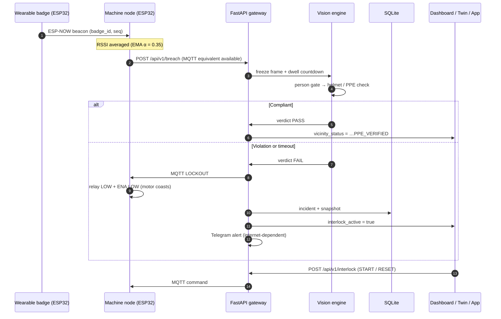
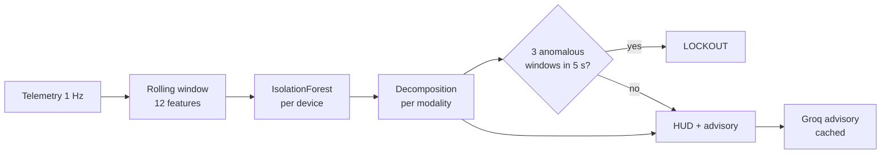
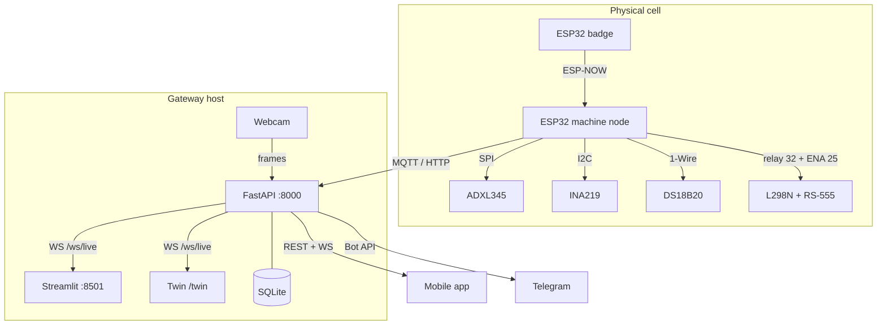

# ARMOR: Active Real-Time Machine & Operator Response System
## System Architecture & Implementation Plan (as built)

> This document describes **what the repository does today**. Where it disagrees
> with `ARMOR Merged Build Spec.md`, the spec's decision log wins; where the spec
> disagrees with the code, the code is right and the spec is the thing to fix.
> Authoritative wiring: `docs/hardware-pinout.md`. Topics and payloads:
> `docs/data-streaming.md`.

---

### 1. Executive summary

**ARMOR (Active Real-Time Machine & Operator Response System)** is an upgrade of the
MachinoCare predictive-maintenance framework. Traditional Industry 4.0 monitoring is
passive — it plots sensor graphs while accidents happen. ARMOR closes the loop:
machine telemetry, worker proximity, edge vision and an ML anomaly gate all resolve
into one state machine, and a violation physically removes power from the motor.

#### Key pillars

* **Machine telemetry baseline** — 12 V RS-555 DC motor instrumented with **ADXL345**
  (3-axis acceleration, RMS, crest factor), **INA219** (bus voltage, armature current,
  power) and **DS18B20** (surface temperature). Sampling runs at 100 Hz on the node and
  is published at 1 Hz. There is no optical encoder and no RPM claim.
* **Proximity triggering (1.5 m restricted zone)** — workers wear an **ESP32 badge**
  broadcasting identifiers over **ESP-NOW**. The machine node measures RSSI, filters it
  with an EMA (α = 0.35, nominal −65 dBm) and posts a breach when the worker enters the
  zone.
* **Person-gated vision inspection** — the camera runs continuously but the feed
  **freezes** the moment a person is detected, a dwell countdown runs, and a Roboflow
  workflow (RF-DETR + SAM 3) checks helmet/PPE compliance on that frozen frame. A local
  CV path is the fallback when the API key or network is missing.
* **Automated physical lockout** — a violation, or a sustained ML anomaly, publishes
  `LOCKOUT` on `machinocare/v1/devices/{id}/interlock`. The node cuts 12 V on the relay
  (GPIO 32, active-LOW) and drives ENA (GPIO 25) LOW.
* **Multi-modal anomaly detection** — a per-device IsolationForest over 12 features
  across vibration, current, voltage, power and temperature, with per-modality
  decomposition and a rolling-window lockdown gate.
* **LLM advisory** — the decomposition is summarized into a root-cause note by Groq
  (Qwen 3.8 by default) and streamed to every client.
* **Three operator surfaces** — Streamlit control room, a Three.js digital twin, and a
  React Native / Expo mobile app, all driven by the same `/ws/live` snapshot.

---

### 2. Topology

1. **Physical layer**
   * **Machine node (ESP32)** — ADXL345 over SPI, INA219 over I2C, DS18B20 over 1-Wire;
     relay + ENA for actuation; publishes telemetry and posts breach events.
   * **Wearable badge (ESP32)** — ESP-NOW beacons only (`sender_mac`, `badge_id`,
     `sequence_num`, `battery_voltage`) plus a buzzer for local alerts.
2. **Gateway layer (`armor-backend/backend`)** — FastAPI app owning MQTT ingest
   (`machinocare/v1/#`), HTTP ingest, SQLite, the vision engine, the anomaly engine,
   the advisory client and the WebSocket fan-out. It also serves the twin page and
   inspection snapshots.
3. **Operator layer** — Streamlit dashboard (`dashboard/app.py`), the twin
   (`static/twin.html`), and the Expo app on the `armor-app` branch.
4. **Data and alerting layer** — SQLite tables (telemetry, machine_state, incidents,
   worker_badges, breach_events, interlock_log), Telegram bot for violation snapshots,
   Groq for advisory text.

---

### 3. Data flow

#### 3.1 Closed-loop event sequence



#### 3.2 Anomaly path



#### 3.3 Network topology



---

### 4. Components

#### 4.1 Hardware pinout (summary)

Authoritative table: `docs/hardware-pinout.md`. The essentials:

| Function | GPIO |
|---|---|
| L298N ENA (PWM) | 25 |
| L298N IN1 / IN2 | 26 / 27 |
| Relay IN1 (master 12 V, active-LOW) | 32 |
| INA219 SDA / SCL | 21 / 22 |
| DS18B20 DATA (4.7 kΩ pull-up) | 15 |
| ADXL345 CS / SCK / MOSI / MISO | 5 / 18 / 23 / 19 |

`LOCKOUT` = relay LOW + ENA LOW. `RESET` = relay HIGH, drive still stopped until a
`START` is requested.

#### 4.2 Vision pipeline

1. **Continuous ingestion** — OpenCV grabs frames (~30 fps) from `CAMERA_SOURCE`
   (index or file), optionally through `CAMERA_BACKEND` (`dshow`, `msmf`).
2. **Person gate** — a light detector (YOLOv8n / Haar / HOG) watches the frame. No
   person, no inference cost.
3. **Freeze** — on detection the feed freezes on that frame and overlays
   `FEED FROZEN — ANALYZING HELMET & PPE COMPLIANCE`. A **dwell countdown**
   (configurable via `/api/v1/vision/dwell-seconds`) can delay the freeze so the worker
   is fully in frame.
4. **Inspection** — the Roboflow workflow `helmet-check-hackathon-demo-1793134805931`
   (RF-DETR + SAM 3) returns the verdict, compliance ratio and an annotated image.
   Without `ROBOFLOW_API_KEY` — or if the workflow call throws — the local helmet-colour
   heuristic answers instead and the result is labelled `ARMOR Edge Vision (Local)`.
   The path is fail-closed: an 8 s inspection timeout returns `compliant: false` /
   `HELMET_FAIL` rather than a silent pass.
5. **Result hold** — verdict and masks are shown for a hold period, then the live feed
   resumes (or `POST /api/v1/vision/unfreeze`). `auto-freeze` can be toggled at runtime.
6. **Consequences** — a violation locks the motor, creates an incident, writes a
   snapshot to `SNAPSHOT_DIR` and attempts a Telegram alert.

Frames are served two ways: `GET /api/v1/vision/frame` (one JPEG; what the mobile app
polls) and `GET /video/stream` (MJPEG, legacy dashboard path). Snapshots are served
from `GET /api/v1/vision/snapshot/{filename}`.

#### 4.3 Anomaly engine (`ml_engine.py`)

* Feature vector (12 values): `mean/std/max acc_mag`, `crest_factor`,
  `mean/std/max current_ma`, `mean/std voltage_v`, `mean power_mw`,
  `mean/max temperature_c`.
* Training: `POST /api/v1/calibrate` builds windows from recorded telemetry
  (≥ 8 windows), fits `IsolationForest` (and a Ridge-distilled scorer), persists to
  disk and caches per device.
* Scoring: each new sample is appended to the device window; the forest returns a
  score, mapped to `anomaly_percentage`, `is_anomaly` and a per-modality
  decomposition (`GET /api/v1/telemetry/anomaly/decomposition/{device_id}`).
* **Lockdown gate:** `ANOMALY_WINDOW_SECONDS` (5.0) and
  `ANOMALY_LOCKDOWN_THRESHOLD` (3) — three anomalous windows inside five seconds
  triggers `LOCKOUT`. Single spikes stay advisory.
* **Advisory:** `groq_advisor.py` turns the decomposition plus recent context into a
  short maintenance note (cached with a TTL, threaded, rate-limited). If no Groq key is
  configured or the call fails, a deterministic expert-rules fallback produces the text
  (`model_used` records which path answered). Exposed as `predictive_advisory` on the
  WebSocket snapshot and `GET /api/v1/telemetry/prediction/{device_id}`.

#### 4.4 Operator surfaces

1. **Streamlit dashboard (`dashboard/app.py`)**
   * Live telemetry cards and tabs for vibration (ADXL345), power (INA219) and
     temperature (DS18B20).
   * Anomaly panel: percentage, modality weights, per-channel deviation, advisory.
   * Vision panel with a `Live Camera` / `3D Digital Twin` switch; the twin runs
     full-width above the charts.
   * Motor control (`START`/`STOP`/`LOCKOUT`/`RESET`), bench-test toggle, inspection
     timing controls, calibration, badge registry, incident log and a debug drawer
     for raw MQTT and the WebSocket feed.
2. **3D digital twin (`static/twin.html`)** — see §4.5.
3. **Mobile app (`armor-app` branch)** — React Native + Expo, five tabs
   (Live, Safety, Vision, Records, System), Material 3 dark "Blueprint Control"
   theme. Talks to the same REST + WebSocket API; motor ON/OFF and lockout go through
   `POST /api/v1/interlock` and surface `409` inline. Ships as a web build for LAN
   testers, native builds via EAS (`@u4up/armor-mobile`).

#### 4.5 Digital twin

Single self-contained page, three.js 0.162 loaded from a CDN importmap, served at
`/twin` and embedded in the dashboard.

* **Model** — base plate with hold-down bolts, cast feet, finned stator, bolted end
  bells, terminal box, nameplate, shaft, coupling, brake disc with caliper, guarded
  pulley, beacon.
* **State mapping** — spindle speed eases toward a target from `motor_state` and
  current draw; the motor assembly carries the vibration (the base stays bolted);
  paint glows with temperature; the caliper clamps on lockout; the beacon is cyan
  idle, green running, amber degraded, strobing red on alarm.
* **Scene** — safety ring and floor fill (green / amber / red), worker marker with
  suit, hi-vis vest, helmet and floor footprint.
* **HUD** — link badge with staleness, per-signal readings, anomaly bar with
  contributor, vibration and temperature sparklines, status pill.
* **Interaction** — orbit/zoom, presets `ISO` / `FRONT` / `TOP`, `?demo=1` scripted
  telemetry, `?host=ip:port` gateway override.
* **Robustness** — WebSocket reconnect with backoff, honest offline state, CDN failure
  message, WebGL context-loss handling, reduced-motion support, DPR-capped renderer.

---

### 5. API contracts (as built)

All routes are browsable at `/docs`.

#### 5.1 Telemetry ingest

`POST /api/v1/telemetry` (202) or MQTT `machinocare/v1/devices/{device_id}/telemetry`.

```json
{
  "device_id": "machino_node_01",
  "timestamp": 1729920000,
  "motor_state": "RUNNING",
  "vibration": { "accel_x": 0.02, "accel_y": 0.05, "accel_z": 0.98,
                 "rms": 0.048, "crest_factor": 2.1 },
  "power": { "voltage_v": 12.1, "current_ma": 420.5, "power_mw": 5088.05 },
  "temperature_c": 34.2
}
```

#### 5.2 Proximity breach

`POST /api/v1/breach` (202) or MQTT `machinocare/v1/events/proximity`.

```json
{
  "device_id": "machino_node_01",
  "worker_id": "BADGE-EMP-402",
  "badge_mac": "24:6F:28:AB:C1:02",
  "rssi_raw": -68,
  "rssi_smoothed": -64.2,
  "distance_est_m": 1.2,
  "timestamp": 1729920015
}
```

#### 5.3 Interlock command

`POST /api/v1/interlock?device_id=machino_node_01`, published on
`machinocare/v1/devices/{device_id}/interlock` (QoS 1).

```json
{
  "command": "START | STOP | LOCKOUT | RESET",
  "source": "MOBILE_APP",
  "reason": "Operator started motor from mobile app",
  "issued_by": "mobile_app",
  "timestamp": 1729920016
}
```

`START` while interlocked → **409**. `RESET` clears the latch without re-energising
the drive. Reset a specific incident with
`POST /api/v1/interlock/reset/{incident_id}`.

#### 5.4 Live stream

`WS /ws/live?device_id=machino_node_01` — `type: "snapshot"` every 0.75 s. Full field
list lives in `README.md` and `docs/data-streaming.md`; the important ones for a
client are `motor_state`, `interlock_active`, `vicinity_status`,
`proximity_breach_active`, `is_anomaly`, `anomaly_percentage`, `top_contributor`,
`predictive_advisory`, `latest_telemetry` and `open_incidents`.

#### 5.5 Vision endpoints

| Endpoint | Purpose |
|---|---|
| `GET /api/v1/vision/frame` | Single JPEG of the current (possibly frozen) frame |
| `GET /video/stream` | MJPEG stream (legacy) |
| `GET /api/v1/vision/status` | Camera/model readiness, frame readiness, snapshot dir |
| `GET /api/v1/vision/state` | Freeze/inspection state machine |
| `POST /api/v1/vision/inspect` | Synchronous check for an existing snapshot |
| `POST /api/v1/vision/inspect/start` · `GET …/inspect/status` | Async inspection |
| `POST /api/v1/vision/unfreeze` | Resume the live feed |
| `GET/POST /api/v1/vision/auto-freeze` | Toggle freeze-on-person |
| `GET/POST /api/v1/vision/dwell-seconds` | Dwell before freeze |
| `GET /api/v1/vision/snapshot/{filename}` | Evidence image |

---

### 6. Deployment topology

| Piece | Default | Notes |
|---|---|---|
| Gateway | `0.0.0.0:8000` | CORS `*`; reachable from phones/ESP32 on the LAN |
| Dashboard | `8501` | Points at `ARMOR_API_URL` |
| Twin | `/twin` on the gateway | Also iframed in the dashboard (560 px tall) |
| MQTT | `localhost:1883` | Mosquitto; gateway subscribes to `machinocare/v1/#` |
| SQLite | `data/armor.db` | Created on first run |
| Snapshots | `data/snapshots` | Served over HTTP, never committed |

All hosts are on one flat LAN during demos. The mobile app's API URL is baked in at
build time, so a native binary only works on that network; the exported **web build**
is the portable option.

---

### 7. Implementation status

| Area | State |
|---|---|
| Telemetry ingest (MQTT + HTTP) | Shipped |
| SQLite storage and incident log | Shipped |
| Dashboard: charts, anomaly deck, advisory | Shipped |
| Vision: person-gated freeze, dwell, Roboflow + fallback | Shipped |
| Motor START/STOP, bench mode, lockout/reset | Shipped |
| Multi-modal anomaly engine + rolling gate | Shipped |
| 3D digital twin | Shipped |
| Mobile app (Expo, 5 tabs) | Shipped on `armor-app` |
| Telegram alerts | Shipped (internet-dependent) |
| Face recognition | Stretch, disabled by default |
| RPM / encoder | Removed by design |
