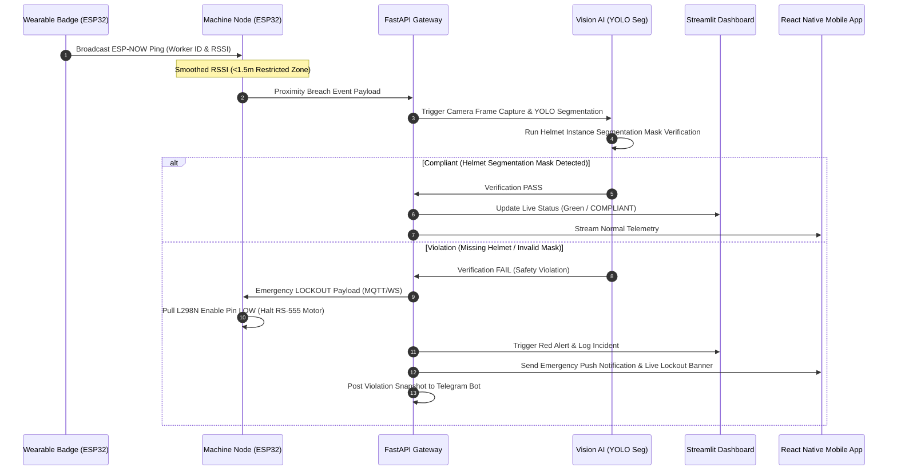
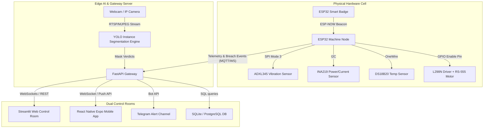

# ARMOR: Active Real-Time Machine & Operator Response System
## System Architecture & Complete Implementation Plan

---

### 1. Executive Summary & Core Pitch

**ARMOR (Active Real-Time Machine & Operator Response System)** is an evolutionary upgrade of the MachinoCare predictive maintenance framework. While traditional Industry 4.0 monitoring systems operate passively—plotting sensor graphs on remote dashboards—ARMOR introduces an **active, closed-loop cyber-physical safety cell**. It bridges predictive machine telemetry with real-time worker proximity detection, edge computer vision, and automated physical power interlocks to prevent workplace accidents before they occur.

#### Key Architectural Pillars
* **MachinoCare 1.0 Machine Telemetry Baseline**: Monitors 12V RS-555 DC motor health using **ADXL345** (3-axis acceleration, RMS, Crest Factor, FFT), **INA219** (bus voltage, armature current, power draw), and **DS18B20** (surface temperature). *(Note: The LM393 optical encoder has been removed to free GPIO lines and reduce timer interrupt overhead).*
* **Proximity Triggering (1.5-Meter Restricted Zone)**: Workers wear an **ESP32 smart badge** broadcasting unique identifiers via **ESP-NOW** radio protocol. Signal strength (RSSI) is filtered using an Exponential Moving Average (EMA) to detect when a worker enters the 1.5m machine danger perimeter.
* **Event-Driven AI Inspection**: Instead of streaming continuous 24/7 video, proximity breach events activate an edge camera pipeline. A **YOLO instance segmentation model** (e.g., YOLOv8-seg / YOLOv11-seg) trained on a **motorcycle helmet dataset** evaluates helmet compliance via pixel-precise polygon mask verification over the worker's head region.
* **Automated Physical Lockout (Hazard Mitigation)**: Upon detecting a safety violation, the backend issues an instant emergency **LOCKOUT payload**. The machine node ESP32 immediately pulls the **L298N motor driver's Enable pin LOW**, physically halting motor rotation in milliseconds.
* **Dual Control Rooms & Instant Alerting**: 
  * **Streamlit Operator Control Room**: A web dashboard displaying live sensor charts, camera streams with colored segmentation masks, interlock status, and timestamped SQLite incident logs.
  * **React Native Expo Mobile App**: A cross-platform mobile app providing floor managers with real-time cell status, instant push notifications with violation snapshots, and a manual emergency interlock override button.

---

### 2. System Architecture & Topology

ARMOR is structured across four interconnected layers:

1. **Physical Hardware & Sensor Layer**:
   * **Machine Node (ESP32)**: Collects telemetry from ADXL345 (SPI Mode 3), INA219 (I2C), and DS18B20 (OneWire). Controls the L298N driver's Enable pin (GPIO) for hardware actuation.
   * **Wearable Badge (ESP32)**: Compact battery-powered unit broadcasting ESP-NOW packets with MAC address, Worker ID, and signal power. Includes a localized piezo buzzer for proximity alerts.
2. **Edge AI & Gateway Layer**:
   * **FastAPI Gateway**: Handles MQTT telemetry ingestion (via Eclipse Mosquitto), manages WebSocket streams, processes proximity breach events, and coordinates emergency lockout payloads.
   * **YOLO Segmentation Engine**: OpenCV-Python worker running YOLO instance segmentation to detect motorcycle helmet compliance and output polygon masks.
3. **Operational Control Room Layer**:
   * **Streamlit Web Dashboard**: Renders live telemetry, embeds video streams via MJPEG/WebSockets, displays interlock states, and logs events.
   * **React Native Expo App**: Native mobile app connecting over WebSockets/REST for live monitoring, push alerts, and manual interlock override.
4. **Data & Alerting Layer**:
   * **SQLite / PostgreSQL Database**: Archives time-series telemetry, incident logs, worker badges, and violation snapshots.
   * **Telegram Bot API & Push Notifications**: Sends real-time violation snapshots and alerts directly to managers.

---

### 3. Data Flow Diagrams (Mermaid)

#### Diagram 1: Closed-Loop Event Sequence



#### Diagram 2: System Network & Hardware Topology



---

### 4. Component Specifications & Implementation

#### 4.1 Hardware Pinout & Wiring (ESP32 Machine Node)
* **ADXL345 (SPI Mode 3)**:
  * `CS`: GPIO 5
  * `SCLK`: GPIO 18
  * `MOSI`: GPIO 23
  * `MISO`: GPIO 19
* **INA219 (I2C)**:
  * `SDA`: GPIO 21
  * `SCL`: GPIO 22
* **DS18B20 (OneWire)**:
  * `DATA`: GPIO 4 (4.7kΩ pull-up resistor)
* **L298N Motor Driver Control**:
  * `ENA` (Motor Enable): GPIO 14 (Pulled HIGH for normal operation; driven LOW for LOCKOUT)
  * `IN1`: GPIO 27 (Motor Direction A)
  * `IN2`: GPIO 26 (Motor Direction B)
* **Proximity Buzzer / Status LED**:
  * `BUZZER`: GPIO 12
  * `RED_LED`: GPIO 13 (Violation Indicator)
  * `GREEN_LED`: GPIO 15 (Normal State Indicator)

#### 4.2 Vision AI & Helmet Instance Segmentation
* **Model Choice**: YOLOv8-seg or YOLOv11-seg trained on motorcycle helmet datasets.
* **Segmentation vs. Bounding Box**: Instance segmentation outputs pixel masks ($M \in \mathbb{R}^{H 	imes W}$). The vision engine extracts the worker's head Region of Interest (ROI) and computes mask overlap area:
  $$	ext{Compliance Ratio} = rac{	ext{Area}(	ext{Helmet Mask} \cap 	ext{Head ROI})}{	ext{Area}(	ext{Head ROI})}$$
* **Thresholding**: If $	ext{Compliance Ratio} \ge 0.65$, helmet status is **PASS**; otherwise **FAIL**.

#### 4.3 Control Room Interfaces
1. **Streamlit Web Dashboard (`dashboard/app.py`)**:
   * Embedded live video frame buffer rendered via `StreamingResponse` (MJPEG).
   * Real-time Altair/Plotly plots for ADXL345 vibration RMS, INA219 current, and DS18B20 temperature.
   * Incident log table backed by SQLite with snapshot viewing capabilities.
2. **React Native Expo Mobile App**:
   * Screen 1: **Live Overview** — Real-time motor status card, active worker badge ID, and live RMS telemetry.
   * Screen 2: **Interlock Control** — Manual override button ("EMERGENCY LOCKOUT" / "RESET INTERLOCK").
   * Screen 3: **Violation Logs** — Push notification feed displaying incident snapshots and timestamps.

---

### 5. API Contracts & JSON Schemas

#### 5.1 Machine Telemetry Payload (`armor/machine01/telemetry`)
```json
{
  "device_id": "machino_node_01",
  "timestamp": 1729920000,
  "motor_state": "RUNNING",
  "vibration": {
    "accel_x": 0.02,
    "accel_y": 0.05,
    "accel_z": 0.98,
    "rms": 0.048,
    "crest_factor": 2.1
  },
  "power": {
    "voltage_v": 12.1,
    "current_ma": 420.5,
    "power_mw": 5088.05
  },
  "temperature_c": 34.2
}
```

#### 5.2 Proximity Breach Event Payload (`armor/gateway/breach`)
```json
{
  "device_id": "machino_node_01",
  "worker_id": "WORKER_EMP_402",
  "badge_mac": "24:6F:28:AB:C1:02",
  "rssi_raw": -58,
  "rssi_smoothed": -60.5,
  "distance_est_m": 1.2,
  "timestamp": 1729920015
}
```

#### 5.3 Emergency Lockout Command Payload (`armor/machine01/interlock`)
```json
{
  "command": "LOCKOUT",
  "source": "VISION_AI_PIPELINE",
  "reason": "MISSING_HELMET_SEGMENTATION_VIOLATION",
  "worker_id": "WORKER_EMP_402",
  "timestamp": 1729920016
}
```

---
